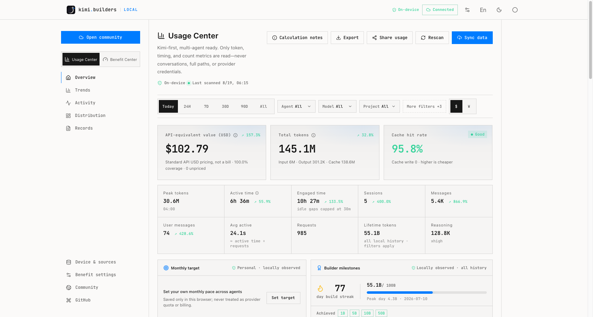
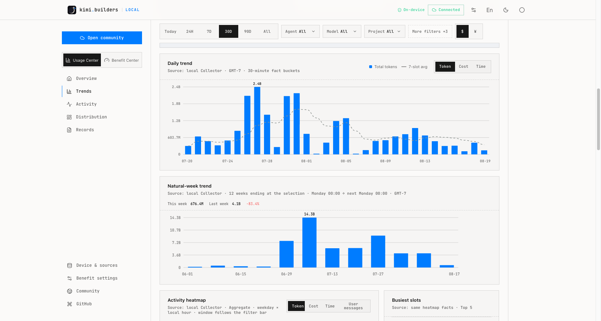
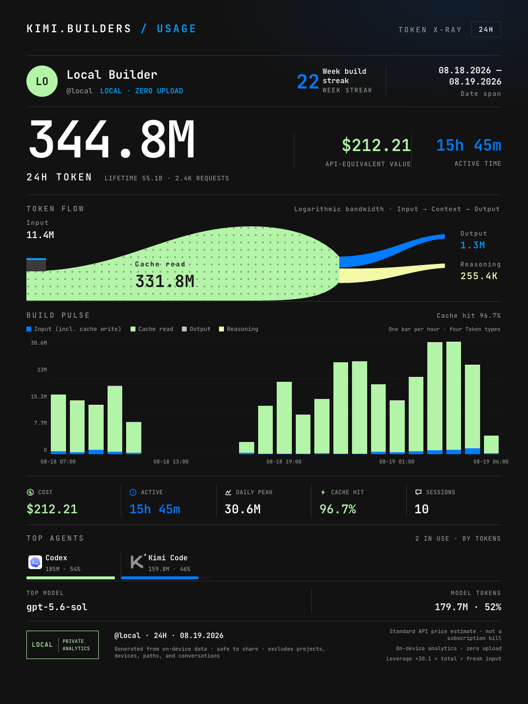
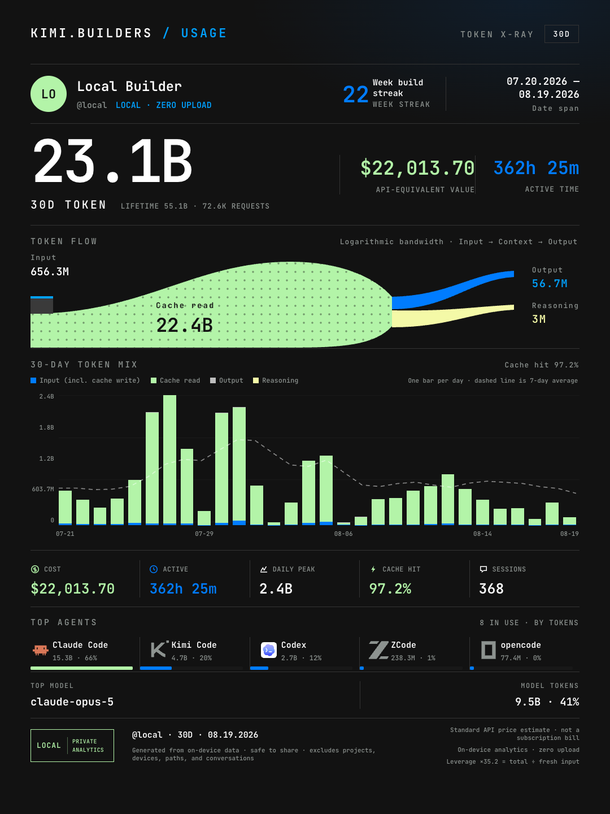
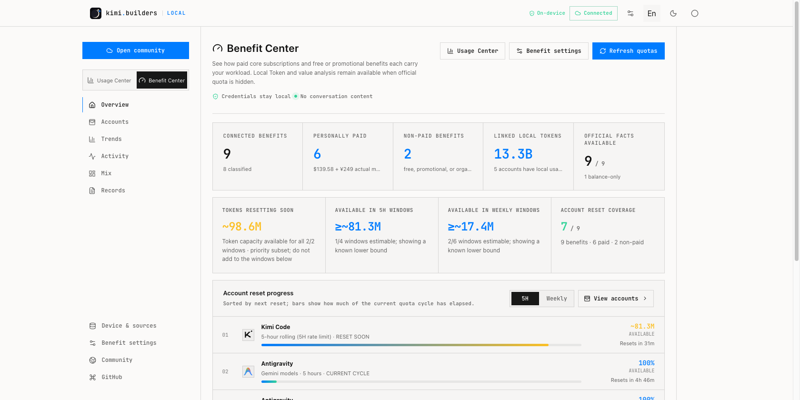

# Kimi Builders Usage

[简体中文](./README.md) · [English](./README.en.md)

[](https://www.npmjs.com/package/@kimi.builders/usage)
[](https://github.com/kimi-builders/usage/actions/workflows/ci.yml)
[](./LICENSE)

**See AI coding agent token usage, cost estimates, and activity in one local dashboard.**

Kimi Builders Usage provides a CLI and a local web dashboard for logs already
stored by Kimi Code, Claude Code, Codex, OpenCode, and other agents. Compare usage
across agents and models, break it down by project, and track activity over time.
No account or changes to your existing agent workflow are required.

## Quick start

Works on macOS, Linux, and Windows with [Node.js 20+](https://nodejs.org/).
No desktop app or global npm installation is needed:

```bash
npx @kimi.builders/usage@latest dashboard
```

1. On your first npx run, enter `y` when prompted to download the package.
   Installation does not scan logs.
2. In the browser wizard, select the agents you want to analyze, set them to
   “Local only”, and start the scan.
3. When the scan finishes, choose “Stay local for now” to open the dashboard.

Run the same command to reopen it. Press “Rescan” to read new logs, and use
`Ctrl+C` in the terminal to stop. Local scanning and analysis work offline;
the initial npm download requires a network connection.

If an agent is missing, run the offline diagnostic:

```bash
npx @kimi.builders/usage@latest inspect --dry-run
```

[Supported sources](#supported-local-usage-sources) · [Commands](#command-reference) ·
[Troubleshooting](./SUPPORT.en.md) · [All docs](./docs/README.en.md)

<details>
<summary>Let an agent install and launch it</summary>

Copy this prompt into Codex, Claude Code, Kimi Code, or another agent that can
operate your local terminal. It will check the environment, inspect sources,
and start the dashboard:

```text
Read https://github.com/kimi-builders/usage/blob/main/README.en.md and follow its
current instructions to set up and launch Kimi Builders Usage on this computer.

Requirements:
1. Prefer the published package and npx; do not clone the repository or install
   anything globally unless there is a concrete reason.
2. Check `node --version` first. Node.js 20+ is required. If Node is missing or
   too old, explain the safest installation option for this OS and ask before
   installing or upgrading it.
3. Run `npx @kimi.builders/usage@latest inspect --dry-run` and summarize which
   Agent sources were detected. Do not expose full local paths, credentials,
   session identifiers, or conversation content in your response.
4. Run `npx @kimi.builders/usage@latest dashboard`, keep the process running,
   and open the authorized local dashboard URL. If automatic opening fails,
   tell me to copy the URL directly from my terminal; do not paste its capability
   token into chat.
5. This request is local-only. Do not run `init`, `sync`, `daemon`, enable quota
   providers, upload data, or change privacy settings unless I explicitly ask.
6. If a command fails, diagnose the real error, apply only the smallest safe
   fix, retry it, and finish with a short summary of what is running and how I
   can stop or restart it.
```

</details>



## What you get

- **Combined usage:** see multiple agents together, with input, cache-write,
  cache-read, output, and reasoning tokens shown separately.
- **Model and project analysis:** filter by agent, model, project, reasoning
  effort, or agent version to find the largest consumers, where logs provide those fields.
- **Activity and trends:** explore Today, 24H, 7D, 30D, 90D, or all history,
  with calendar-week comparisons, hourly activity, request counts, and sessions.
- **Cost estimates:** value usage at standard API prices, with pricing coverage
  and unpriced tokens visible alongside the estimate.
- **Personal goals:** set a monthly target and track hourly usage spikes,
  active-day streaks, and token milestones.
- **Portable results:** export CSV / JSON or create a usage poster. CLI commands
  also provide statistics, rankings, and exports directly in the terminal.



Posters show token breakdowns, frequently used agents, leading models, and activity.
They exclude projects, devices, full paths, and conversation content. Custom avatars
are processed and saved on this device across restarts. The screenshots and posters
in this README were generated from real local agent logs.

<p align="center">
  
  
</p>

## Supported local usage sources

There are 17 automatically scanned sources, plus an explicit opt-in for Cursor CSV.
The project is in public Beta; maturity varies by source as shown below.

| Agent | Status | Local source |
| --- | --- | --- |
| Kimi Code | Core | `~/.kimi-code` and legacy `~/.kimi` |
| Claude Code | Stable | `$CLAUDE_CONFIG_DIR` and project logs under `~/.claude*` |
| Codex | Stable | Current and archived sessions under `$CODEX_HOME` or `~/.codex` |
| OpenCode | Stable | SQLite database with legacy JSON fallback |
| Gemini CLI | Stable | JSONL/JSON sessions under `~/.gemini/tmp` |
| Antigravity | Stable | Offline SQLite stores from App 2.0 / standalone IDE / `agy` CLI |
| GitHub Copilot CLI | Stable | Local CLI session logs |
| Roo Code | Stable | Local VS Code extension task data |
| Pi Coding Agent | Beta | JSONL sessions such as `~/.pi/agent/sessions`; format coverage is still growing |
| ZCode | Beta | Local SQLite session store; Node 20 may require a system `sqlite3` |
| WorkBuddy / CodeBuddy | Beta | Local WorkBuddy/CodeBuddy project session store |
| Grok CLI | Beta | Sessions and exact turn usage under `$GROK_HOME` or `~/.grok` |
| Trae CLI | Beta | Local CLI session, trace, and event logs |
| MiniMax Code | Beta | Token ledger in `~/.minimax/v2/sqlite/runtime-state.sqlite` |
| Qoder / Qoder CN | Beta | Separate sources; IDE SQLite tokens and CLI/app sessions; credits are never converted into tokens |
| DeepSeek Harness (DSH) | Beta | V0–V4 JSONL / multi-frame Zstd under `$DSH_HOME/sessions`; inherited-session deduplication |
| Cursor | Explicit opt-in | Usage CSV exported by Cursor Dashboard |

Qoder routing tiers such as `auto` are left unpriced as `qoder-auto`, never treated as concrete models.
Compressed DSH logs require Node ≥22.15 with built-in Zstd or an installed `zstd` binary.
Missing decompression support is reported as a partial source failure.

Sources are parsed independently. A missing, damaged, or changed source never
blocks another source; incomplete results are reported separately.
These diagnostics stay offline:

```bash
npx @kimi.builders/usage inspect --dry-run
npx @kimi.builders/usage doctor
npx @kimi.builders/usage sources list
```

`doctor --json` is designed for issue reports. It excludes paths, projects,
models, session IDs, and row timestamps, but still contains aggregate counts and
redacted parser errors. Review it before sharing.

Cursor is currently the only usage source that first needs a data file. Beginners
can paste and verify its full CSV path during first-run setup or under **Local &
sources** in the dashboard; terminal users can also run:

```bash
npx @kimi.builders/usage sources enable cursor --csv /path/to/usage.csv
npx @kimi.builders/usage sources disable cursor
```

Dashboard verification and the CLI command only store the local CSV path, without
network access. See the
[source compatibility matrix](./docs/SOURCE_COMPATIBILITY.en.md) for maturity,
limitations, and verification evidence.

Codex, Antigravity, Pi, Grok, and Trae CLI accept multiple data directories
under **Local & sources**, for custom locations and independent installations.
Full paths stay in local configuration; the browser receives directory names
only. The CLI equivalents are `sources add-root <agent> /absolute/directory`
and `sources remove-root <agent> /absolute/directory`.

## How to read the data

| Data | Meaning and limits |
| --- | --- |
| Locally observed usage | Tokens, requests, sessions, and timing extracted from selected agent logs. Unrecorded activity is outside the totals. |
| Provider quotas | Usage percentages, reset times, credits, or balances returned by a provider after you enable queries. Units stay as reported. |
| Derived estimates | Standard-API costs, token capacity, and usage forecasts. They depend on pricing, evidence windows, or sampling assumptions and are not actual bills or official fixed token caps. |
| User-entered information | Monthly goals, subscription prices, billing cycles, and renewal dates, kept separate from observations and provider quotas. |

Cost estimates use a bundled pricing catalog, matching models by effective date,
context tier, and processing tier. You can explicitly download a public catalog
in the dashboard or with `pricing update`; that download contains no local usage.
Failed validation preserves the last valid catalog, and the bundled snapshot
remains available offline. Official provider documentation is authoritative;
third-party pricing aggregators are used only for maintainer drift checks and
are not runtime dependencies for scanning or the dashboard.

Session timing follows the same definition across tools:

- **Active time:** gaps between assistant/tool events within a turn, capped at five minutes each.
- **Engaged time:** user-to-assistant/tool turn gaps, capped at 30 minutes each.
- A long-lived session ID cannot turn offline days into continuous work.

See [Local Snapshot v1](./docs/LOCAL_SNAPSHOT_V1.en.md) for fields and formulas.

The Codex performance card uses only local turns with a complete request ledger
and successful completion timing. It follows usage filters and shows time to first
token, whole-turn output throughput, median duration, and sample counts. Missing
timing is never inferred from Token counts. Whole-turn throughput includes tool
and waiting time, not just model generation. Performance samples stay local and
are never uploaded to the community.

## Subscription limits (optional)

Open “Benefit Center → Benefit settings” in the dashboard and enable the
providers you want to check. Queries are off by default.
The Collector contacts a provider only after you enable it, using an existing
local login or a credential source you choose.

Current integrations cover Codex, Claude Code, Kimi Code, Cursor, GitHub
Copilot, Antigravity, Kiro, DeepSeek, OpenCode Go, Qoder, Warp, JetBrains AI, WorkBuddy,
GLM / Z.ai, MiniMax, and Alibaba Coding Plan.
Depending on the provider, setup can use local detection, an
environment variable, or macOS Keychain. Trae has no stable independently
verifiable personal-limit interface, so it is labeled unavailable rather than
showing invented data.

**Connect GLM, MiniMax, or Alibaba:** open Benefit settings → All platforms,
expand the provider, select your plan's region, and follow its credential instructions.
GLM and MiniMax use plan API keys;
Alibaba Coding Plan uses a console Cookie. See the [connection guide](./docs/CODING_PLAN_SETUP.en.md).
These integrations show official quota facts only; model names alone never assign local Tokens to a plan.

**Connect WorkBuddy:** expand its card in Benefit settings and follow the steps to
manually enter the Cookie and User-Agent from the same website request, or supply
the tuple through `WORKBUDDY_SESSION_JSON`. The view shows official total,
remaining, and reserved Credits, plus a cycle end when available. It never reads
browser cookies automatically or assumes that the website account owns local
WorkBuddy Tokens.

When Claude Code reports reset vouchers or promotional cloud Credits, these are
shown separately from regular quota and subscription spending. Renewal/expiry
dates are optional: explicitly provide the same account's OAuth token and website
Cookie, and dates appear only after account and organization verification. Missing
credentials or a failed optional check do not affect existing quota queries.

Google retired the individual Gemini CLI OAuth benefit surface, so it is no
longer a Subscription Center provider. Existing Gemini CLI local Token history
remains available through the offline parser. Antigravity first reuses an
already-running, signed-in Antigravity or `agy` loopback service to read the
Gemini and Claude/GPT five-hour and weekly pools. Quota checks never start or
terminate the user's process. Explicit Antigravity OAuth or CodexBar credentials
are used only when no usable local service is available.

Kiro reuses the local Kiro CLI login read-only and queries official credits;
usage-cli neither executes Kiro CLI nor owns token refresh. Each OpenCode Go
account independently chooses either an API key or Cookie + Workspace ID. Its
credential, quota facts, and user-entered subscription details are never shared
with another account.

**Kimi multi-account quotas:** Keep the local CLI login and add separate Kimi for Coding API-key accounts
inside the same Kimi Code settings card. Use the account picker after saving. Only reported five-hour,
monthly or legacy weekly windows appear; keys for one account share its quota. Cross-client logs cannot yet
reliably identify each request's key, so per-key Token usage is not invented.
See [multi-account setup and login recovery](./docs/KIMI_CODE_LOGIN.en.md).

DeepSeek uses an explicitly configured API key with the public balance endpoint.
It shows per-currency total, topped-up, and granted money balances and never
converts money into a Token quota. A separate local model-family view groups
DeepSeek model records across Agents; those records may overlap their Agent
benefit view, do not prove use of the configured API-key account, and are
deduplicated in portfolio totals.

Kimi Code appears first by default. Grab the handle to drag any enabled provider
into place with a mouse or touch; the order is stored locally and reused for both
quota tabs and provider requests.

Every successful refresh stores one sanitized quota snapshot locally. The
Subscription Center aligns changes in the same provider window with local Token
usage to show burn pace, projected utilization at reset, 30-day cost per
million tokens based on user-entered spend, standard-API-equivalent value, and model concentration. Every
observation identifies its evidence window. It never changes a plan automatically
or presents observed utilization as a provider-published fixed Token cap.

Quota credentials and responses never enter token snapshots or exports. Manual secrets are not stored in the normal `config.json`.
Sanitized history is retained for at most 400 days and downsampled as it ages; it
also stays out of exports and posters. Provider endpoints and
authentication boundaries are in [NETWORK.md](./NETWORK.md), and locally stored
fields are documented in [PRIVACY.md](./PRIVACY.md).



## Command reference

Append these commands to `npx @kimi.builders/usage`. Run `--help` for all options.

| Command | Purpose | Network |
| --- | --- | --- |
| `stats [--period 7d\|30d\|today] [--source agent]` | Multi-dimensional offline analytics with daily ASCII trend chart | No |
| `quota [--provider name] [--all] [--json]` | Query subscription quota, multi-window progress bars and reset countdowns (alias `limits`) | Only for configured providers |
| `top [--period 30d]` | Show rankings for top models, agent sources, and projects | No |
| `export [--format csv\|json\|jsonl] [-o PATH]` | Export local usage metrics as standard CSV / JSON / JSONL | No |
| `dashboard [--no-open] [--port N]` | Start the local interactive visual Web dashboard | No by default |
| `status` | Show local runtime status, config, and connection details | No |
| `pricing status\|update\|reset` | Inspect or explicitly update pricing, or restore the bundled offline snapshot | status/reset No; update Yes |
| `inspect --dry-run` | Show roots and parser results | No |
| `doctor [--json]` | Produce a redacted compatibility report | No |
| `sources list` | Show local usage-source status and policies | No |
| `sources set <agent> off\|local` | Set one agent's local scan scope | No |
| `completion [zsh\|bash\|fish]` | Generate Shell auto-completion scripts | No |

Global options: `--lang en|zh` (select language, defaults to OS locale auto-detection), `--no-color` / `--plain` (disable ANSI colors), `--json` (structured JSON output).

Local configuration lives under
`~/.kimi-builders/usage/`. Sensitive config files use mode `0600` on POSIX.

## Data and privacy

The Collector reads selected logs to extract usage. Prompts, responses, reasoning
text, tool results, file contents, repository remotes, and full paths are excluded
from usage snapshots. Local results may keep project-directory names for analysis.
Raw session IDs are transformed with HMAC-SHA-256 and a random installation-local
salt, so different devices cannot correlate the result.

The dashboard server listens only on `127.0.0.1`, creates a fresh browser access
token on each launch, and rejects unauthorized requests and unexpected Host/Origin
values. Local usage scans do not read quota credentials; quota queries require
separate opt-in settings.

Theme, language, goals, and poster avatars are saved on this device across restarts.
Provider credentials and sanitized quota history are managed separately; manual
credentials are not stored in the ordinary config file. See [privacy](./PRIVACY.md)
and the [per-command network inventory](./NETWORK.md) for details.

## Documentation and feedback

The project is in public Beta. Stable sources have cross-platform fixtures and
contract tests; Beta sources are still gaining log-format coverage. For missing
data or format differences, follow the troubleshooting guide to share redacted diagnostics.

[Troubleshooting](./SUPPORT.en.md) · [Source compatibility](./docs/SOURCE_COMPATIBILITY.en.md) ·
[Roadmap](./docs/ROADMAP.en.md) · [Release notes](./docs/RELEASE_NOTES_0.6.3.en.md) ·
[Contributing](./CONTRIBUTING.en.md) · [Security reporting](./SECURITY.md) · [Threat model](./THREAT_MODEL.md)

## Run from source

```bash
git clone https://github.com/kimi-builders/usage.git
cd usage
npm run setup
npm run dev
```

`npm run setup` installs dashboard development dependencies once. `npm run dev`
starts the local API and Vite dashboard together; a second terminal is not
needed. README examples use `npx @kimi.builders/usage …`; in a checkout, replace
that prefix with `node ./bin/kbu-usage.js …`.

To keep the browser closed:

```bash
npm run dev -- --no-open
```

## Development and verification

Before a commit:

```bash
npm test
npm run dashboard:build
npm run dashboard:test
```

Before a release:

```bash
npm run release:check
```

This runs Collector tests, builds and tests the dashboard, and uses
`npm pack --dry-run` to show the exact package contents. `npm publish` runs the
same gate through `prepublishOnly`, but the check command never publishes by
itself. See [PUBLISHING.md](./PUBLISHING.md).

Tests redirect every source, config, and state path to temporary fixtures. They
do not read the developer's real HOME.

Before submitting code changes, follow
the relevant privacy and test checklist in [CONTRIBUTING.en.md](./CONTRIBUTING.en.md).
Do not open a public Issue for a vulnerability; use the private reporting path
documented in [SUPPORT.en.md](./SUPPORT.en.md).

## License and acknowledgements

The complete project is released under the [MIT License](./LICENSE). Original
project contributions are © 2026 `kimi.builders contributors`.

Parts of the initial parser layer and related tests were adapted from the
MIT-licensed [`@vibe-cafe/vibe-usage`](https://github.com/vibe-cafe/vibe-usage).
The Vibe Usage desktop clients were direct product references, and parts of the
provider-specific quota protocols and parsers were adapted from CodexBar. Code
adaptations, product references, and bundled dependencies are recorded
separately and do not imply joint ownership, maintenance, or endorsement. See
[NOTICE](./NOTICE) for the complete provenance record.

## Connect and sync the community (optional)

[kimi.builders](https://kimi.builders/usage) is a separate web application. If you
want cross-device aggregation or community participation, you can choose to send
redacted usage aggregates there. This package's local analytics work independently.

Connection, allowed sources, and background operation are separate choices.
Project upload is off by default; provider credentials and quota history are
excluded. See the [optional integration guide](./docs/COMMUNITY_SYNC.en.md) for
authorization, sync commands, and background-service setup.
