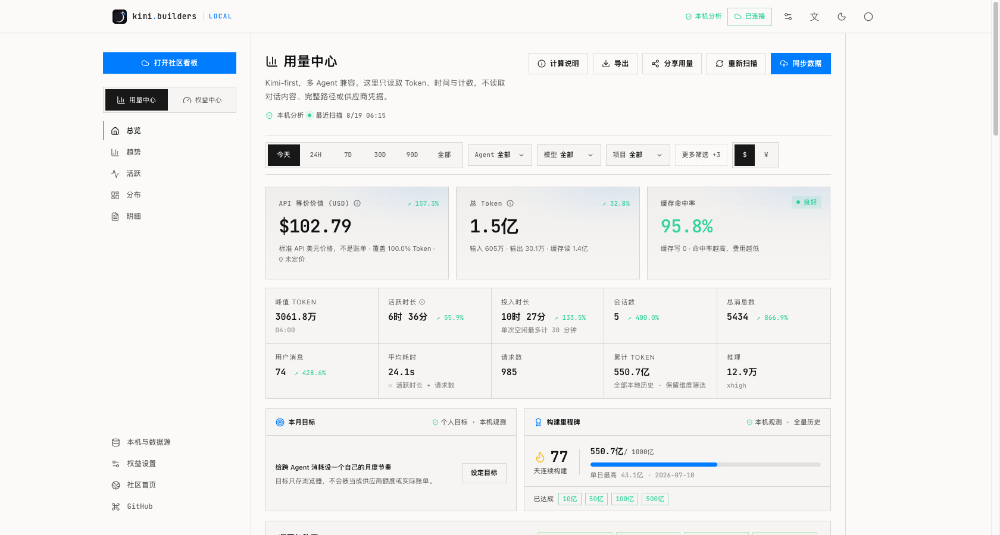
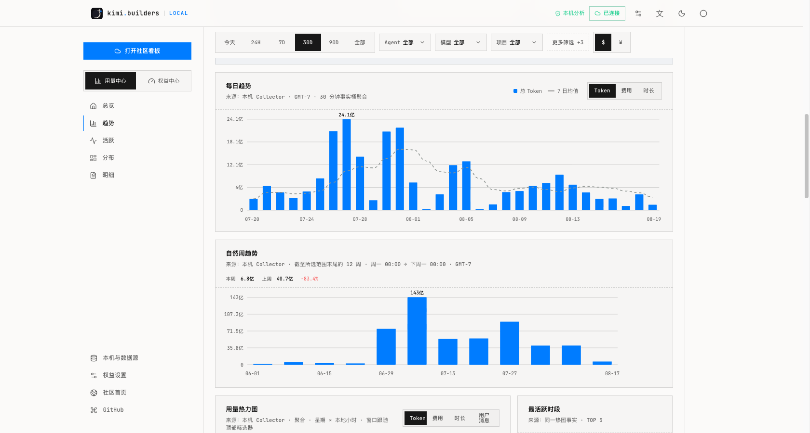
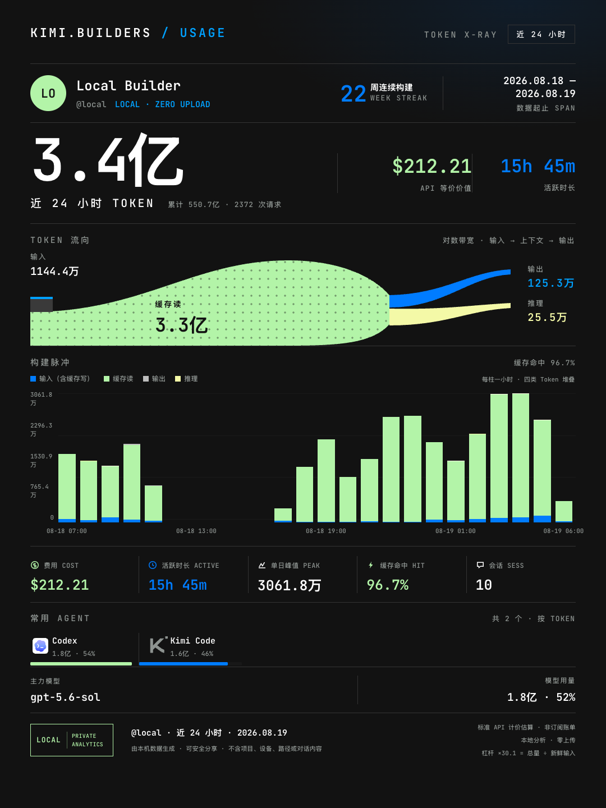
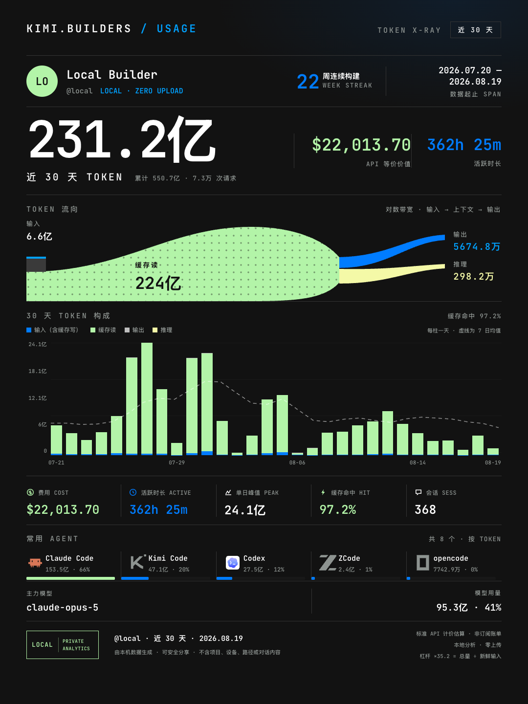
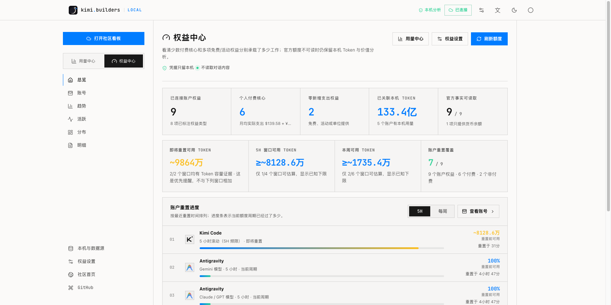

# Kimi Builders Usage

[简体中文](./README.md) · [English](./README.en.md)

[](https://www.npmjs.com/package/@kimi.builders/usage)
[](https://github.com/kimi-builders/usage/actions/workflows/ci.yml)
[](./LICENSE)

**在本机统一查看 AI 编程工具的 Token 用量、费用估算与工作节奏。**

Kimi Builders Usage 提供命令行和本地 Web 看板，读取 Kimi Code、Claude Code、Codex、
OpenCode 等工具已有的日志。你可以比较不同 Agent 和模型的消耗、按项目查看用量，
追踪活跃时间与使用趋势。无需注册账号，也不需要改变现有的 Agent 工作流。

## 快速开始

支持 macOS、Linux、Windows，需要 [Node.js 20+](https://nodejs.org/)。
无需安装桌面应用或全局 npm 包：

```bash
npx @kimi.builders/usage@latest dashboard
```

1. 首次使用 npx 时，按提示输入 `y` 下载包。安装过程不会扫描日志。
2. 在浏览器向导中选择要分析的 Agent，将其设为“仅本机”，然后开始扫描。
3. 扫描完成后选择“先只看本机”，即可进入用量看板。

后续运行同一命令即可重新打开。点击“重新扫描”读取最新日志，使用完在终端按 `Ctrl+C` 停止。
本地扫描与分析不需要网络；首次下载 npm 包需要联网。

如果没有识别到某个 Agent，可以先运行离线诊断：

```bash
npx @kimi.builders/usage@latest inspect --dry-run
```

[支持来源](#支持的本地用量来源) · [命令速查](#常用命令) ·
[排查问题](./SUPPORT.md) · [全部文档](./docs/README.md)

<details>
<summary>让 Agent 帮你安装和启动</summary>

不熟悉终端也没关系。复制下面的提示词发给 Codex、Claude Code、Kimi Code 或其他能操作
本机终端的 Agent，它会检查环境、扫描来源并启动看板：

```text
阅读 https://github.com/kimi-builders/usage/blob/main/README.md，并按照当前文档在
这台电脑上安装和启动 Kimi Builders Usage。

要求：
1. 优先使用已发布的 npm 包和 npx；除非有明确理由，否则不要克隆仓库或全局安装。
2. 先运行 `node --version`。项目要求 Node.js 20+。如果未安装或版本过低，先说明适合
   当前操作系统的最安全安装方式，得到我确认后再安装或升级。
3. 运行 `npx @kimi.builders/usage@latest inspect --dry-run`，简要说明检测到了哪些
   Agent 来源。回复中不要暴露完整本机路径、凭据、会话标识或对话内容。
4. 运行 `npx @kimi.builders/usage@latest dashboard`，保持进程运行并打开已授权的本地
   看板地址。如果无法自动打开，让我从终端直接复制地址；不要把其中的 capability token
   粘贴到聊天中。
5. 这次只使用本地功能。除非我明确要求，否则不要运行 `init`、`sync` 或 `daemon`，
   不要启用额度 Provider、上传数据或修改隐私设置。
6. 如果命令失败，定位真实原因，只做最小且安全的修复后重试；最后简要说明当前运行状态，
   以及如何停止或重新启动。
```

</details>



## 你能得到什么

- **统一用量：** 在一张看板里汇总多个 Agent，查看输入、缓存写、缓存读、输出和推理 Token。
- **模型与项目分析：** 按 Agent、模型、项目、推理强度或 Agent 版本筛选，定位主要消耗来源；字段以日志可提供的信息为准。
- **时间与趋势：** 查看今天、24H、7D、30D、90D 和全部历史，比较自然周趋势、分时活跃、请求与会话数量。
- **费用参考：** 按标准 API 价格估算用量价值，同时显示定价覆盖率和未定价 Token。
- **个人目标：** 设置月度目标，查看小时用量激增提示、连续活跃天数与 Token 里程碑。
- **带走结果：** 导出 CSV / JSON，或生成用量海报；终端用户也可直接查询统计、排行和导出数据。



海报展示 Token 构成、常用 Agent、主力模型和活跃节奏，不包含项目、设备、完整路径或对话内容。
自定义头像在本机处理和保存，重启后仍保留。本文截图与海报来自真实本机 Agent 日志。

<p align="center">
  
  
</p>

## 支持的本地用量来源

内置 17 个自动扫描来源，另支持显式启用 Cursor CSV。当前为公开 Beta；各来源的成熟度如下。

| Agent | 状态 | 本机来源 |
| --- | --- | --- |
| Kimi Code | 核心 | Kimi CLI、Kimi Work 和旧版 `~/.kimi` 的本地会话。Work 默认仅本机；用 `sources set kimi-code private --include-desktop` 明确纳入同步，去掉该参数重新执行即恢复仅同步 CLI。 |
| Claude Code | 稳定 | `$CLAUDE_CONFIG_DIR`、`~/.claude*` 的项目日志；同一 API 请求的多个内容块只计一次 |
| Codex | 稳定 | `$CODEX_HOME` 或 `~/.codex` 的当前与归档会话；支持 `.jsonl.zst` 压缩历史（需要支持 Zstd 的 Node 或系统 `zstd`） |
| OpenCode | 稳定 | SQLite 数据库，旧版 JSON 回退 |
| Gemini CLI | 稳定 | `~/.gemini/tmp` 中的 JSONL/JSON 会话 |
| Antigravity | 稳定 | App 2.0 / 独立 IDE / `agy` CLI 的离线 SQLite 会话库 |
| GitHub Copilot CLI | 稳定 | 本机 CLI 会话日志 |
| Roo Code | 稳定 | VS Code 扩展的本地任务数据 |
| Pi Coding Agent | Beta | `~/.pi/agent/sessions` 等 JSONL 会话；格式覆盖仍在扩充 |
| ZCode | Beta | 本机 SQLite 会话库；Node 20 可能需要系统 `sqlite3` |
| WorkBuddy / CodeBuddy | Beta | WorkBuddy/CodeBuddy 本机项目会话存储 |
| Grok CLI | Beta | `$GROK_HOME` 或 `~/.grok` 下的会话与精确 turn usage |
| Trae CLI | Beta | 本机 CLI session、trace 与 event 日志 |
| MiniMax Code | Beta | `~/.minimax/v2/sqlite/runtime-state.sqlite` 的 Token ledger |
| Qoder / Qoder CN | Beta | 两个独立来源；IDE SQLite Token、CLI/App 会话；积分不转换成 Token |
| DeepSeek Harness（DSH） | Beta | `$DSH_HOME/sessions` 的 V0–V4 JSONL / 多帧 Zstd；继承会话去重 |
| Cursor | 显式启用 | Cursor Dashboard 主动导出的 Usage CSV |

Qoder 的 `auto` 等路由档位会标为 `qoder-auto` 等未定价项，不冒充具体模型。
DSH 压缩日志需要 Node ≥22.15 的内置解压或已安装的 `zstd`；无法解压时会提示部分失败。

每个来源独立解析。一个来源损坏、未安装或格式变化，不会阻塞其他来源；
不完整的结果会单独标注。可先运行以下命令检查环境，全程不联网：

```bash
npx @kimi.builders/usage inspect --dry-run
npx @kimi.builders/usage doctor
npx @kimi.builders/usage sources list
```

`doctor --json` 适合附在 Issue 中：它不包含路径、项目、模型、会话 ID 或时间明细，
但仍含汇总数量与脱敏错误，分享前请自行检查。

Cursor 是当前唯一需要先提供数据文件的用量来源。新手可在首次设置或看板的
“本机与数据源”中粘贴 CSV 完整路径并验证；终端用户也可以执行：

```bash
npx @kimi.builders/usage sources enable cursor --csv /path/to/usage.csv
npx @kimi.builders/usage sources disable cursor
```

看板验证和启用命令只保存本机 CSV 路径，不会联网。各来源的成熟度、限制和验证证据见
[来源兼容矩阵](./docs/SOURCE_COMPATIBILITY.md)。

Codex、Antigravity、Pi、Grok 与 Trae CLI 支持在“本机与数据源”中添加多个数据目录，
适合自定义位置或多个独立安装。完整路径只保存在本机配置，浏览器只看到目录名；CLI 等价方式为
`sources add-root <agent> /绝对/目录` 与 `sources remove-root <agent> /绝对/目录`。

## 数据口径

| 数据 | 含义与边界 |
| --- | --- |
| 本机观测用量 | 从已选 Agent 日志提取的 Token、请求、会话和时间信息；未记录的使用不在统计范围内。 |
| 供应商额度 | 启用查询后由供应商返回的使用比例、重置时间、Credits 或余额，保留原始单位。 |
| 派生估计 | 标准 API 费用、额度容量和消耗预测；依赖价格、证据窗口或采样前提，不代表实际账单或官方固定 Token 上限。 |
| 用户填写的信息 | 月度目标、订阅价格、付费周期和续费日期；与观测值和供应商额度分开呈现。 |

费用估算使用随包内置的价格目录，按模型、生效时间、上下文档位和处理档位匹配。
需要新价格时，可在看板中或通过 `pricing update` 主动下载公开目录；下载不包含本机用量。
目录校验失败会保留上一次有效版本，离线时可使用内置快照。官方供应商文档是价格依据，
第三方价格聚合器仅用于维护者的变化检查，不是扫描或看板的运行时依赖。

会话时间采用跨工具一致的口径：

- **活跃时长：** 同一轮 assistant/tool 事件之间的间隔，每段最多计 5 分钟。
- **投入时长：** user 到 assistant/tool 的轮内时间线，每段最多计 30 分钟。
- 长期复用的 session ID 不会把离线数天计为连续工作时间。

字段与计算方式见 [本地快照 v1](./docs/LOCAL_SNAPSHOT_V1.md)。

Codex 性能卡只统计有完整请求账本及成功完成计时的本机轮次，显示首字延迟、整轮输出吞吐量、
时长中位数和样本数，并跟随用量筛选。缺失计时不会按 Token 数猜测；整轮吞吐量包含工具与等待
时间，不代表模型纯生成速度。这些性能样本只供本机看板使用，不上传社区。

## 订阅额度（可选）

在看板进入“权益中心 → 权益设置”，启用你想查看的平台。

订阅额度查询默认关闭；只有你在本地设置里启用某个平台，
Collector 才会复用该平台的本机登录或读取你指定的凭据并发起查询。

当前支持 Codex、Claude Code、Kimi Code、Cursor、GitHub Copilot、Antigravity、Kiro、
DeepSeek、OpenCode Go、Qoder、Warp、JetBrains AI、WorkBuddy、GLM / Z.ai、MiniMax 与百炼 Coding Plan。不同平台支持自动检测、
环境变量或 macOS 钥匙串中的一种或多种方式。Trae 暂无稳定且可独立验证的个人额度接口，
因此只显示“暂不可查”，不会生成猜测数据。

**连接 GLM、MiniMax 或百炼：** 进入“权益设置 → 全部平台”，展开对应卡片，选择购买套餐的
地区并按卡片说明填写凭据。GLM、MiniMax 使用套餐 API Key，百炼
Coding Plan 使用控制台 Cookie。详见[三平台连接指南](./docs/CODING_PLAN_SETUP.md)。
它们目前只展示官方额度，不凭模型名把本机 Token 强行算进某份订阅。

**连接 WorkBuddy：** 在权益设置展开 WorkBuddy 卡片，按提示从同一次官网请求中手动填写
Cookie 与 User-Agent，或通过 `WORKBUDDY_SESSION_JSON` 提供该凭据组合。查询显示官方 Credits
总额、剩余、预留及可用的周期结束时间；不会自动读取浏览器 Cookie，也不会把官网账户与本机
WorkBuddy Token 直接关联。

Claude Code 若返回重置券或赠送云端 Credits，会单独展示，不计入常规额度或订阅支出。
续费/到期日期为可选信息：需要你明确提供同一账户的 OAuth Token 与网站 Cookie；只有账户及
组织核验一致才显示。未提供或核验失败不影响已有额度查询。

Gemini CLI 的个人版 OAuth 权益入口已由 Google 退役，因此不再作为权益 Provider；已有的
Gemini CLI 本机 Token 历史仍由离线 Parser 保留。Antigravity 会优先复用已经运行并登录的
Antigravity 或 `agy` 回环服务，读取 Gemini 与 Claude/GPT 的 5 小时和每周额度；工具不会为
额度查询自动启动或终止用户进程。没有可用本机服务时，才会使用用户明确配置的 Antigravity
OAuth 或 CodexBar 凭据。

Kiro 会只读复用 Kiro CLI 的本地登录并查询官方 Credits；工具不会执行 Kiro CLI 或接管
令牌续期。OpenCode Go 的每个账户可单独选择 API Key，或选择 Cookie + Workspace ID；
两种方式的凭据、额度与用户填写的订阅信息都不会跨账户共享。

**Kimi 多账号：** 在同一张 Kimi Code 设置卡片保留本机 CLI 登录，再为其他账户添加独立的
Kimi for Coding API Key；保存后用账户选择器切换查看。只显示官方返回的 5 小时、月度或旧周额度，
同账户多个 Key 共享额度。跨客户端日志尚不能可靠归属到具体 Key，因此不会据此虚构每个 Key 的
Token 消耗。详见[多账号设置与登录恢复](./docs/KIMI_CODE_LOGIN.md)。

DeepSeek 使用用户明确配置的 API Key 查询公开余额接口，只展示按币种返回的总余额、充值余额
与赠送余额，不把货币换算成 Token 额度。权益中心会另外按 DeepSeek 模型标识汇总各 Agent 的
本机用量；这条模型家族证据可能与对应 Agent 权益视图重叠，也不能证明请求属于当前 API Key
账户，组合总量会按原始记录去重。

额度页默认把 Kimi Code 放在第一位。你可以在设置中抓住手柄直接拖动已启用平台，桌面
鼠标和移动端触控都可用；排序保存在本机，并同时用于额度页签和查询顺序。

每次成功刷新都会在本机保存一份脱敏额度快照。订阅中心会把相同供应商、相同时间窗的
额度变化与本机 Token 对齐，显示消耗速度、重置时预计用量、基于用户填写支出的近 30 天单位 Token 成本、
标准 API 等价价值和模型集中度。所有建议都附带证据窗口，仅供续费与工作流决策参考；它
不会自动改套餐，也不会把订阅利用率描述成供应商公布的固定 Token 上限。

额度凭据和响应不会进入 Token 快照或导出文件。手动 Secret 不写入普通
`config.json`。脱敏历史最多保留 400 天，较旧数据自动降采样；它同样不会进入导出文件或海报。
各平台网络目标和认证边界见 [网络行为](./NETWORK.zh.md)，本地保存字段见 [隐私说明](./PRIVACY.zh.md)。



## 常用命令

以下命令均接在 `npx @kimi.builders/usage` 后；完整参数可通过 `--help` 查看。

| 命令 | 作用 | 网络 |
| --- | --- | --- |
| `stats [--period 7d\|30d\|today] [--source agent]` | 本地多维离线用量统计与每日 ASCII 趋势图 | 无 |
| `quota [--provider name] [--all] [--json]` | 查询 AI 平台订阅额度、多窗口进度条与倒计时（别名 `limits`） | 仅限已登录/配置平台 |
| `top [--period 30d]` | 按消耗量查看模型、来源与项目排行 | 无 |
| `export [--format csv\|json\|jsonl] [-o PATH]` | 导出本地用量数据为标准 CSV / JSON / JSONL | 无 |
| `dashboard [--no-open] [--port N]` | 启动本地交互式可视化 Web 看板 | 默认无 |
| `status` | 查看本地运行状态、配置与连接信息 | 无 |
| `pricing status\|update\|reset` | 查看、主动更新价格目录，或恢复随包内置离线快照 | status/reset 无；update 有 |
| `inspect --dry-run` | 显示读取目录与来源扫描结果 | 无 |
| `doctor [--json]` | 生成脱敏兼容性与数据一致性报告 | 无 |
| `sources list` | 查看本地用量来源状态与策略 | 无 |
| `sources set <agent> off\|local` | 设置单个 Agent 的本机扫描范围 | 无 |
| `completion [zsh\|bash\|fish]` | 生成 Shell 自动补全脚本 | 无 |

通用参数：`--lang en|zh`（指定语言，默认自动检测系统语言）、`--no-color` / `--plain`（禁用 ANSI 颜色）、`--json`（结构化输出）。

本地配置位于 `~/.kimi-builders/usage/`；POSIX 系统上的敏感配置文件权限为
`0600`。

## 数据与隐私

Collector 读取你选中的日志来提取用量，不把 prompt、response、reasoning 正文、tool result、
文件内容、仓库 remote 或完整路径写入用量快照。本地结果可保留项目目录名供分析；原始
session ID 经安装级随机盐和 HMAC-SHA-256 转换，不同设备无法用结果互相对照。

看板服务只监听 `127.0.0.1`，每次启动生成新的浏览器访问令牌，并拒绝未授权请求及不符合要求
的 Host / Origin。本地用量扫描不读取额度凭据；额度查询需在设置中单独启用。

主题、语言、目标和海报头像等偏好保存在本机，可跨重启恢复。供应商凭据与脱敏额度历史
分开管理，手动凭据不写入普通配置文件。详情见 [隐私说明](./PRIVACY.zh.md) 和
[逐命令网络清单](./NETWORK.zh.md)。

## 文档与反馈

当前为公开 Beta。稳定来源有跨平台 fixture 和契约测试覆盖；Beta 来源的日志格式仍在持续验证。
遇到数据缺失或格式差异，请按排障指南提供脱敏诊断。

[排障与反馈](./SUPPORT.md) · [来源兼容矩阵](./docs/SOURCE_COMPATIBILITY.md) ·
[开发路线](./docs/ROADMAP.md) · [发布说明](./docs/RELEASE_NOTES_0.6.4.md) ·
[参与开发](./CONTRIBUTING.md) · [安全报告](./SECURITY.zh.md) · [威胁模型](./THREAT_MODEL.zh.md)

## 从源码运行

```bash
git clone https://github.com/kimi-builders/usage.git
cd usage
npm run setup
npm run dev
```

`npm run setup` 只在第一次安装看板开发依赖。`npm run dev` 会同时启动本地 API 和 Vite
看板，不需要两个终端。本文示例使用 `npx @kimi.builders/usage …`；源码目录中可替换为
`node ./bin/kbu-usage.js …`。

如果不想自动打开浏览器：

```bash
npm run dev -- --no-open
```

## 开发与验证

提交前：

```bash
npm test
npm run dashboard:build
npm run dashboard:test
```

发布前完整检查：

```bash
npm run release:check
```

它会运行 Collector 测试、构建并测试看板，再执行 `npm pack --dry-run` 展示实际发布内容。
`npm publish` 也会通过 `prepublishOnly` 自动执行同一套检查，但不会在检查命令中被调用。
发布流程见 [发布清单](./PUBLISHING.zh.md)。

测试会把来源、配置和状态目录指向临时 fixture，不读取开发者真实的 HOME。

提交代码改动前，请先阅读
[CONTRIBUTING.md](./CONTRIBUTING.md) 中对应类别的隐私与测试清单。安全漏洞请勿公开建 Issue，
使用 [SUPPORT.md](./SUPPORT.md) 提供的私密报告入口。

## License 与来源说明

本项目整体以 [MIT License](./LICENSE) 开源；项目原创部分 © 2026
`kimi.builders contributors`。

初始 parser 层的部分实现与测试改编自 MIT 许可的
[`@vibe-cafe/vibe-usage`](https://github.com/vibe-cafe/vibe-usage)。产品与额度能力还参考了
Vibe Usage 的桌面客户端；部分 provider 额度协议与解析实现改编自 CodexBar。代码改编、
产品参考与打包依赖被分开记录，不表示相关项目共同拥有、参与维护或为本项目背书。
完整来源见 [NOTICE](./NOTICE)。

## 连接与同步社区（可选）

[kimi.builders](https://kimi.builders/usage) 是独立的 Web 应用。如果需要跨设备汇总或参与
社区展示，可以选择将脱敏后的聚合用量同步到那里。本包的本地分析功能不依赖该应用。

连接、允许同步的来源和后台运行都由你单独选择；项目名默认不上传，供应商凭据及额度历史
不参与同步。授权步骤、同步命令和后台服务说明见 [可选集成指南](./docs/COMMUNITY_SYNC.md)。
